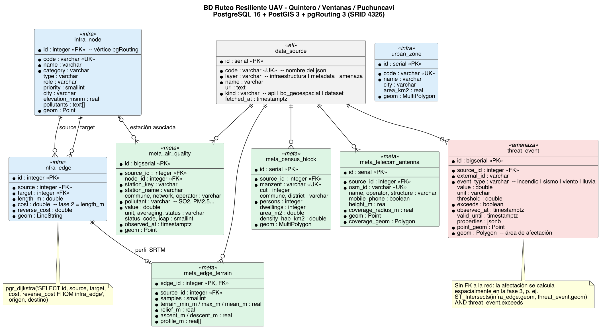

# Guía de la base de datos (diagrama explicado)

Esta guía explica, con palabras simples, cómo está armada la base de datos del proyecto y cómo leer
el diagrama `bd_diagrama.png`.



---

## 1. Conceptos básicos para leer el diagrama

| Concepto | Qué significa | Ejemplo en nuestra BD |
|---|---|---|
| **Tabla** | Una "planilla" con filas y columnas | `infra_node` guarda los nodos |
| **Fila** | Un elemento | El Aeródromo de Quintero es una fila de `infra_node` |
| **PK** (Primary Key, llave primaria) | Columna que identifica cada fila de forma única; no se repite | `infra_node.id` |
| **FK** (Foreign Key, llave foránea) | Columna que apunta a la PK de **otra** tabla; así se relacionan las tablas | `infra_edge.source` apunta a `infra_node.id` |
| **UK** (Unique Key) | Columna que no puede repetirse, aunque no sea la PK | `infra_node.code` (`base_scer`) |
| **geom** | Columna espacial de PostGIS: guarda un punto, una línea o un polígono | `geometry(Point, 4326)` |
| **4326** | Código del sistema de coordenadas WGS84 (longitud, latitud), el mismo de Google Maps y GPS | Todas las geometrías |

### Cómo leer los símbolos del diagrama

- `*` antes de una columna = **obligatoria** (no puede quedar vacía).
- Las líneas entre tablas son relaciones. Los extremos dicen **cuántos**:

```text
   ||  = exactamente uno          o{  = cero o muchos
   |o  = cero o uno               o|  = cero o uno

   infra_node ||───────o{ infra_edge
   "un nodo"            "puede estar en cero o muchas aristas"
```

### Los colores

| Color | Grupo | Tablas |
|---|---|---|
| Azul | Infraestructura (la red) | `infra_node`, `infra_edge`, `urban_zone` |
| Verde | Metadata (información extra) | `meta_air_quality`, `meta_edge_terrain`, `meta_census_block`, `meta_telecom_antenna` |
| Rojo | Amenazas (eventos que bloquean) | `threat_event` |
| Gris | Control del ETL | `data_source` |

---

## 2. Regla general: un archivo → una tabla

Cada `.geojson` que generan los scripts se guarda en una tabla:

| Archivo | Tabla | Una fila es... |
|---|---|---|
| `infraestructura/nodos.geojson` | `infra_node` | un nodo |
| `infraestructura/aristas.geojson` | `infra_edge` | una arista |
| `infraestructura/zonas_urbanas.geojson` | `urban_zone` | una zona urbana |
| `metadata/sinca_calidad_aire.geojson` | `meta_air_quality` | **una medición** (estación + contaminante + hora) |
| `metadata/srtm_relieve.geojson` | `meta_edge_terrain` | el perfil de terreno de una arista |
| `metadata/ine_manzanas.geojson` | `meta_census_block` | una manzana censal |
| `metadata/osm_antenas.geojson` | `meta_telecom_antenna` | una antena |
| `amenazas/*.geojson` (los 4) | `threat_event` | un evento (incendio, sismo, celda de viento o celda de lluvia) |
| *(el bloque `etl` de cada archivo)* | `data_source` | una fuente de datos |

---

## 3. Las tablas una por una

### 3.1 `data_source`: de dónde viene cada dato

Es un catálogo con **una fila por archivo/fuente**. Las tablas de metadata y amenazas apuntan aquí
para saber de dónde salió cada dato y cuándo se descargó.

| Columna | Qué guarda | Ejemplo |
|---|---|---|
| `id` (PK) | Número de la fuente | `4` |
| `code` (UK) | Nombre del archivo | `sinca_calidad_aire` |
| `layer` | Grupo: `infraestructura`, `metadata` o `amenaza` | `metadata` |
| `name` | Nombre de la fuente | `SINCA - Ministerio del Medio Ambiente` |
| `url` | Dirección de la API | `https://sinca.mma.gob.cl/...` |
| `kind` | Tipo: `api`, `bd_geoespacial` o `dataset` | `api` |
| `fetched_at` | Cuándo se descargó | `2026-10-18 21:34` |

> Para qué sirve: en la presentación se puede mostrar que cada dato tiene su origen registrado.

---

### 3.2 `infra_node`: los nodos (lugares)

| Columna | Qué guarda | Ejemplo |
|---|---|---|
| `id` (PK) | Número del nodo. **pgRouting usa este número** | `1` |
| `code` (UK) | Nombre corto y estable | `base_scer` |
| `name` | Nombre | `Aeródromo de Quintero (SCER)` |
| `category` | Tipo de lugar | `base`, `sinca`, `health`... |
| `type`, `role` | Detalle del tipo y su papel en la misión | `Base de Despacho Principal` |
| `priority` | Prioridad de monitoreo | `0` |
| `city` | Localidad | `Quintero` |
| `elevation_msnm` | Altura del terreno (metros sobre el mar) | `28` |
| `pollutants` | Lista de contaminantes (tipo arreglo `text[]`) | `{SO2,PM10,PM2.5}` |
| `geom` | **Punto** en el mapa | `POINT(-71.5173 -32.7842)` |

---

### 3.3 `infra_edge`: las aristas (calles aéreas)

Esta es la tabla que usa **pgRouting** para calcular rutas.

| Columna | Qué guarda | Ejemplo |
|---|---|---|
| `id` (PK) | Número de la arista | `15` |
| `source` (FK → `infra_node.id`) | Nodo de inicio | `1` |
| `target` (FK → `infra_node.id`) | Nodo de llegada | `42` |
| `length_m` | Largo en metros | `350.2` |
| `cost` | Costo de ir de `source` a `target`. **Hoy = largo** | `350.2` |
| `reverse_cost` | Costo de ir de vuelta (`target` a `source`) | `350.2` |
| `geom` | **Línea** entre los dos nodos | `LINESTRING(...)` |

**Relación:** cada arista tiene **dos FK** hacia `infra_node` (las dos líneas "source" y "target"
del diagrama). Un nodo puede estar en muchas aristas.

```text
   infra_node (id=1, Aeródromo) ◄── source ──┐
                                             infra_edge (id=15, 350 m)
   infra_node (id=42, Colegio)  ◄── target ──┘
```

> **¿Por qué `cost` y `reverse_cost`?** pgRouting los exige. Hoy son iguales (la arista es de ida y
> vuelta). En la fase 3 podrían ser distintos: por ejemplo, volar contra el viento cuesta más que a favor.

---

### 3.4 `urban_zone`: zonas urbanas (polígonos)

| Columna | Qué guarda | Ejemplo |
|---|---|---|
| `id` (PK) | Número | `1` |
| `code` (UK) | Nombre corto | `urban_quintero` |
| `name`, `city` | Nombre y localidad | `Zona Urbana Quintero` |
| `area_km2` | Área | `9.62` |
| `geom` | **Polígono** del pueblo | `MULTIPOLYGON(...)` |

No tiene FK: se relaciona con la red **por ubicación** (ver sección 4).

---

### 3.5 `meta_air_quality`: contaminación (SINCA)

**Una fila = una medición.** Una estación que mide 5 contaminantes genera 5 filas.

| Columna | Qué guarda | Ejemplo |
|---|---|---|
| `id` (PK) | Número | `1` |
| `source_id` (FK → `data_source`) | De qué fuente viene | `4` (SINCA) |
| `station_key`, `station_name` | Estación | `501`, `Campiche` |
| `commune`, `network`, `operator` | Comuna, red y empresa | `Puchuncaví`, `ENEX` |
| `node_id` (FK → `infra_node`, **opcional**) | Nodo de la red que corresponde a la estación | `3` (o vacío si no hay nodo) |
| `pollutant` | Contaminante | `SO2` |
| `value`, `unit` | Valor y unidad | `8.44`, `µg/m3N` |
| `averaging` | Cómo se promedia | `concentración 1 h` |
| `status`, `status_code` | Estado de la calidad del aire | `bueno`, `1` |
| `icap` | Índice de calidad | `2` |
| `observed_at` | Hora de la medición | `2026-10-18 16:00 -04` |
| `geom` | **Punto** de la estación | `POINT(...)` |

- **Relación opcional con `infra_node`** (`|o--o{` en el diagrama): una estación puede no tener nodo.
  Hoy pasa con Los Maitenes y Valle Alegre, y su `node_id` queda vacío (`NULL`).
- **No se repite** la misma estación + contaminante + hora (`UNIQUE`), así que cargar dos veces no duplica datos.

---

### 3.6 `meta_edge_terrain`: relieve bajo cada arista (SRTM)

**Una fila = una arista.** Por eso su PK es directamente el `id` de la arista.

| Columna | Qué guarda | Ejemplo |
|---|---|---|
| `edge_id` (PK y FK → `infra_edge`) | La arista medida | `15` |
| `source_id` (FK → `data_source`) | Fuente | `5` (SRTM) |
| `samples` | Cuántos puntos se midieron | `5` |
| `terrain_min_m`, `terrain_max_m`, `terrain_mean_m` | Altura mínima, máxima y media del suelo | `4`, `16`, `11.6` |
| `relief_m` | Diferencia entre máximo y mínimo | `12` |
| `ascent_m`, `descent_m` | Cuánto se sube y se baja recorriendo la arista | `12`, `1` |
| `profile_m` | Lista con la altura de cada punto (arreglo `real[]`) | `{4,11,16,12,15}` |

- **Relación uno a uno** (`||--o|`): cada arista tiene como máximo un perfil.
- No tiene `geom` propia porque usa la de la arista (se unen con `JOIN`).
- `ON DELETE CASCADE`: si se borra una arista, su perfil se borra solo.

---

### 3.7 `meta_census_block`: población por manzana (INE)

| Columna | Qué guarda | Ejemplo |
|---|---|---|
| `id` (PK) | Número | `1` |
| `source_id` (FK → `data_source`) | Fuente | `6` (INE) |
| `manzent` (UK) | Código oficial de la manzana | `5107011007005` |
| `cut`, `commune`, `district` | Código y nombre de la comuna, y distrito | `5107`, `QUINTERO` |
| `persons` | Personas que viven ahí | `18` |
| `dwellings` | Viviendas | `20` |
| `area_m2` | Área | `5231` |
| `density_hab_km2` | Personas por km² | `3441` |
| `geom` | **Polígono** de la manzana | `MULTIPOLYGON(...)` |

Es la **base de datos geoespacial con polígonos** que pedía la pauta.

---

### 3.8 `meta_telecom_antenna`: antenas y cobertura (OSM)

Esta tabla tiene **dos geometrías**:

| Columna | Qué guarda | Ejemplo |
|---|---|---|
| `id` (PK) | Número | `1` |
| `source_id` (FK → `data_source`) | Fuente | `7` (OSM) |
| `osm_id` (UK) | Código en OpenStreetMap | `node/123456` |
| `name`, `operator`, `structure` | Nombre, empresa y tipo de estructura | `mast` |
| `mobile_phone` | ¿Es de telefonía móvil? | `true` |
| `height_m` | Altura | `30` |
| `coverage_radius_m` | Radio de cobertura supuesto | `3000` |
| `geom` | **Punto**: dónde está la antena | `POINT(...)` |
| `coverage_geom` | **Polígono**: hasta dónde llega la señal (círculo) | `POLYGON(...)` |

---

### 3.9 `threat_event`: todas las amenazas

Los 4 archivos de amenazas (incendios, sismos, viento, lluvia) tienen los **mismos campos base**, así
que van a **una sola tabla**. La columna `event_type` dice qué tipo de evento es cada fila.

| Columna | Qué guarda | Ejemplo incendio | Ejemplo viento |
|---|---|---|---|
| `id` (PK) | Número | `1` | `99` |
| `source_id` (FK → `data_source`) | Fuente | FIRMS | Open-Meteo |
| `external_id` | Código del evento en su fuente | `VIIRS_SNPP_2026-10-14_...` | `r0c0_2026-10-18T21:30` |
| `event_type` | `incendio`, `sismo`, `viento` o `lluvia` | `incendio` | `viento` |
| `value`, `unit` | Valor medido | `3.73 MW` | `9.2 m/s` |
| `threshold` | Límite de seguridad | vacío | `14` |
| `exceeds` | **¿Zona activa?** | `true` | `false` |
| `observed_at` | Cuándo ocurrió | `2026-10-14 19:21` | `2026-10-18 21:30` |
| `valid_until` | Hasta cuándo vale (solo lluvia) | vacío | vacío |
| `properties` | Datos propios de cada fuente (tipo `jsonb`) | `{"satellite": "N", ...}` | `{"wind_speed_120m": 4.67, ...}` |
| `point_geom` | **Punto** central: foco, epicentro o centro de celda | `POINT(...)` | `POINT(...)` |
| `geom` | **Polígono** del área afectada | círculo de 2 km | celda de la grilla |

**¿Qué es `jsonb`?** Una columna que guarda un JSON. Se usa para los datos que solo tiene una fuente
(por ejemplo, la profundidad de un sismo), sin tener que crear una columna para cada uno.

---

## 4. ¿Por qué algunas tablas NO tienen línea hacia la red?

En el diagrama, `urban_zone`, `meta_census_block`, `meta_telecom_antenna` y `threat_event` **no
tienen FK** hacia nodos ni aristas. Es a propósito.

Un incendio no "pertenece" a una arista: simplemente **está en un lugar**. Si mañana cambian las
aristas, el incendio sigue en el mismo sitio. Por eso la relación se calcula **por ubicación** con
funciones de PostGIS:

| Función | Pregunta que responde |
|---|---|
| `ST_Intersects(a, b)` | ¿Se tocan o cruzan estas dos geometrías? |
| `ST_Within(a, b)` | ¿`a` está completamente dentro de `b`? |
| `ST_DWithin(a, b, d)` | ¿Están a menos de `d` de distancia? |

```text
   threat_event (polígono de incendio)
          ╭─────────╮
   A ─────┼────╮    │            La arista A─B cruza el incendio:
          │    ╰────┼───── B     ST_Intersects(arista, incendio) = true
          ╰─────────╯            → con exceeds = true la zona está activa; la fase 3 decide si bloquea la arista
```

---

## 5. Índices: para que las consultas sean rápidas

Un índice es como el índice de un libro: permite encontrar filas sin revisar la tabla completa.

- **Índices GIST** (sobre `geom`): aceleran las preguntas espaciales como `ST_Intersects`. Sin ellos,
  revisar si 633 aristas cruzan 703 manzanas obliga a comparar todas las combinaciones.
- **Índices normales** (sobre `source`, `target`, `category`, etc.): aceleran las búsquedas y los `JOIN`.

---

## 6. Consultas de ejemplo (para entender cómo se usa)

**Ruta más corta del Aeródromo a la estación SINCA Puchuncaví (punto 8):**
```sql
SELECT * FROM pgr_dijkstra(
  'SELECT id, source, target, cost, reverse_cost FROM infra_edge',
  (SELECT id FROM infra_node WHERE code = 'base_scer'),         -- origen
  (SELECT id FROM infra_node WHERE code = 'sinca_puchuncavi'),  -- destino
  directed := true);
```
Devuelve la lista de tramos de la ruta. Hoy da **14,4 km en 22 tramos**.

**Último valor de SO2 de cada estación:**
```sql
SELECT DISTINCT ON (station_name) station_name, value, unit, observed_at
FROM meta_air_quality
WHERE pollutant = 'SO2'
ORDER BY station_name, observed_at DESC;
```

**Aristas bloqueadas por alguna amenaza activa (esto es lo que hará la fase 3):**
```sql
SELECT DISTINCT e.id
FROM infra_edge e
JOIN threat_event t ON ST_Intersects(e.geom, t.geom)
WHERE t.exceeds;
```

**Aristas sin señal celular:**
```sql
SELECT e.id
FROM infra_edge e
WHERE NOT EXISTS (
  SELECT 1 FROM meta_telecom_antenna a WHERE ST_Intersects(a.coverage_geom, e.geom)
);
```
Hoy da 234 aristas.

**Personas que viven bajo cada arista:**
```sql
SELECT e.id, SUM(b.persons) AS personas
FROM infra_edge e
JOIN meta_census_block b ON ST_Intersects(e.geom, b.geom)
GROUP BY e.id
ORDER BY personas DESC;
```

---

## 7. Cómo se conecta con la fase 3

Hoy el costo de una arista es solo su largo. En la fase 3, la idea es calcular un costo que combine
todo lo que guarda esta BD:

```text
   costo = largo
         + penalización por población debajo   (meta_census_block)
         + penalización por subir cerros       (meta_edge_terrain)
         + penalización por no tener señal     (meta_telecom_antenna)
         − premio por ir a zonas contaminadas  (meta_air_quality)
   y se BORRAN de la red las aristas que cruzan una amenaza con exceeds = true (threat_event)
```

Luego se vuelve a correr `pgr_dijkstra` con ese costo nuevo, y la ruta resultante es la **ruta resiliente**.

---

## 8. Cómo crear la BD desde cero

```bash
# Levantar PostgreSQL 16.9 + PostGIS 3.5.2 + pgRouting 3.8.0 (puerto 5433 en tu máquina)
docker compose up -d db

# Crear las tablas (python3 main.py lo hace automáticamente)
docker compose exec -T db psql -U uav -d uav < bd/schema.sql
```

`schema.sql` empieza borrando las tablas (`DROP TABLE IF EXISTS`), así que se puede correr las veces
que haga falta: siempre deja la BD limpia.
